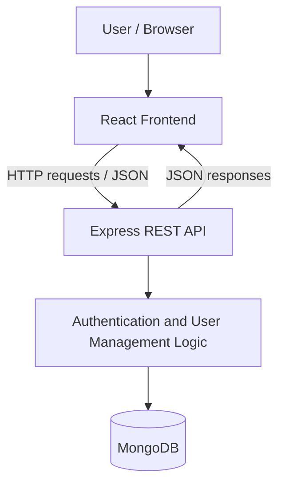

# User Management System

A full-stack  built to demonstrate user registration, authentication, and management of user records through a React frontend and a RESTful Node.js/Express backend.

This repository demonstrates full-stack application development, client–server integration, MongoDB data persistence, and API testing.

## Overview

The User Management System provides a web interface for managing user information. It combines a React.js client with an Express.js API and MongoDB database. The project includes registration and authentication functionality alongside user-management operations.

## Key Features

- User registration and login — account creation and authentication workflows.
- User management (CRUD) — create, view, update, and delete user records.
- Contact us for built with email sending configuration through email.js
- REST API integration — communication between the React frontend and Express backend.
- MongoDB persistence — user information stored and managed using MongoDB.
- JWT-based authentication — token-based authentication as implemented in the project.
- API validation and debugging — endpoints tested using Postman.


## Tech Stack

| Layer | Technologies |
| --- | --- |
| Frontend | React.js, JavaScript, HTML, CSS |
| Backend | Node.js, Express.js |
| Database | MongoDB, Mongoose |
| Authentication | JSON Web Tokens (JWT) |
| API | RESTful HTTP APIs, JSON |
| Testing and debugging | Postman; Jest and Supertest if included in this repository |
| Version control | Git, GitHub |

## Architecture



The frontend presents the user interface and sends requests to the backend. The backend handles application logic, authentication, and database operations.

## Project Structure

```text
User-management-2/
├── Backend/            # Express API and database integration
├── Frontend/           # React application
├── .gitignore
└── README.md
```

*The directory names above match the repository root. See the folders for their current internal structure.*

## Getting Started

### Prerequisites

- Node.js and npm
- MongoDB instance (local or cloud-hosted)
- Git

### 1. Clone the repository

```bash
git clone https://github.com/IT22595744/User-management-2.git
cd User-management-2
```

### 2. Install backend dependencies

```bash
cd Backend
npm install
```

### 3. Configure backend environment variables

Create a `.env` file inside `Backend` and configure the environment variable names **expected by the actual backend source code**. For example, many Node.js applications require values for a MongoDB connection string, a JWT secret, and a server port.

**Do not commit `.env` files, API keys, database passwords, or JWT secrets.**

### 4. Start the backend

Inspect `Backend/package.json` for the available scripts, then run the appropriate command, such as:

```bash
npm run dev
```

*If there is no `dev` script, use the start command defined in `Backend/package.json`.*

### 5. Install and start the frontend

Open a second terminal:

```bash
cd User-management-2/Frontend
npm install
npm run dev
```

*Confirm the correct frontend start script in `Frontend/package.json` (some React setups use `npm start` instead). Configure the frontend API base URL if required.*

## API and Authentication

The backend provides endpoints for user-related operations and authentication. Typical workflows include:

1. Register a new account.
2. Log in with the registered credentials.
3. Receive and use authentication information as required by the application.
4. Create, retrieve, update, or delete user records through the available API endpoints.

**Exact routes, request bodies, and access-control rules:** Add a table here after checking the files inside `Backend` (especially route and controller modules). Avoid documenting routes that the application does not actually expose.

## Testing

- Use **Postman** to send requests to authentication and user-management endpoints.
- Check successful requests, invalid inputs, and error responses.
- If the repository includes automated tests, document the actual test command from `Backend/package.json` and the tested scenarios.

## Screenshots

Add screenshots of the running application to a directory such as `docs/screenshots/`, then replace these placeholders with real image links:

| Screen | Screenshot |
| --- | --- |
| Registration | Add screenshot |
| Login | Add screenshot |
| User list / dashboard | Add screenshot |
| Add or edit user | Add screenshot |

For example, after uploading an image:

```md

```

## Engineering Skills Demonstrated

- Building component-based interfaces with React.js
- Developing and integrating RESTful APIs
- Implementing user registration and authentication workflows
- Working with MongoDB for data persistence
- Handling frontend–backend communication and API responses
- Testing and debugging API behavior
- Organizing a full-stack application into frontend and backend codebases

## Potential Improvements

- Expand automated unit and integration test coverage
- Add role-based authorization where appropriate
- Improve validation, loading states, and user-facing error messages
- Add deployment instructions and a live demo link once hosted
- Document the complete API contract with example requests and responses

## Author

**Muhammad Arshad** — Software Engineering Graduate

- [GitHub](https://github.com/IT22595744)
- [LinkedIn](https://www.linkedin.com/in/mohamed-hilmi-arshad)
- [Portfolio](https://arshad-portfolio-website-tgvm.vercel.app/)

---

**Repository:** [IT22595744/User-management-2](https://github.com/IT22595744/User-management-2)
